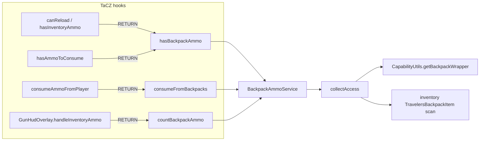

# Architecture

## One-line design

TaCZ asks "does the player have ammo?" only about the player inventory.
Three RETURN-injects OR-in the backpack scan; one drain-inject takes the
remainder after TaCZ empties the inventory. RETURN injects compose with
other backpack mods — a `@Redirect` on the capability lookup is exclusive
and would hard-crash against e.g. the Sophisticated Backpacks bridge.

## Files (`com.poseidon.tacz_tb_compat`)

| File | Role |
|---|---|
| `TaczTbCompat` | `@Mod` entry — registers the SERVER config |
| `config/TbCompatConfig` | `enabled`, `wornBackpack`, `inventoryBackpacks` |
| `service/BackpackAmmoService` | `hasBackpackAmmo`, `countBackpackAmmo`, `consumeFromBackpacks`, `usesVirtualAmmo`, `collectAccess`, `BackpackAccess` record |
| `mixin/AbstractGunItemMixin` | `canReload`, `hasInventoryAmmo` → OR-in `hasBackpackAmmo` |
| `mixin/ModernKineticGunScriptAPIMixin` | `hasAmmoToConsume` → OR-in; `consumeAmmoFromPlayer` → drain remainder |
| `mixin/GunHudOverlayMixin` | `handleInventoryAmmo` → add backpack count to `cacheInventoryAmmoCount` |

## Rules

- `remap = false` on all mixins — TaCZ method names are mod-defined; the
  used APIs are identical across TaCZ 1.1.5 → 1.1.8-hotfix2 (verified
  per-jar)
- `usesVirtualAmmo` guards the consume path — dummy/inventory-feed guns
  never touch real backpack contents
- `hasBackpackAmmo` mirrors TaCZ's own scan: matching `IAmmo` OR matching
  `IAmmoBox` per slot; `countBackpackAmmo` mirrors
  `GunHudOverlay.handleInventoryAmmo` incl. the creative-box 9999
- Must work client-side — `LocalPlayerReload` gates the reload packet on
  a client `canReload` check
